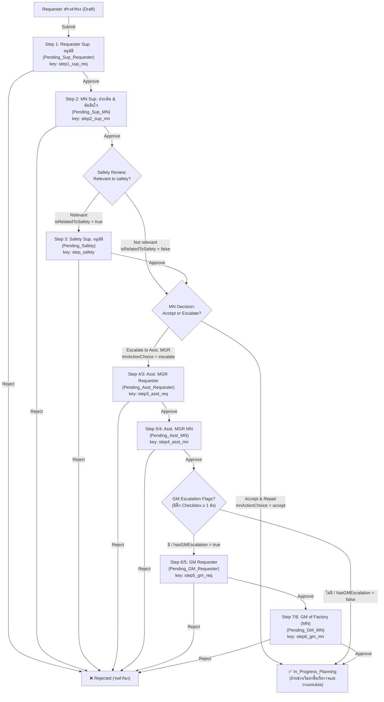
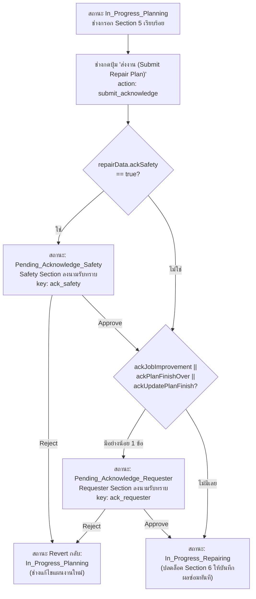

# รายละเอียดขั้นตอนการอนุมัติคำร้องงานซ่อมบำรุง (Maintenance Work Request Approval Workflow)

**เอกสารอ้างอิง:** FM-MN-012 Maintenance Work Request Rev.13  
**อ้างอิงจากซอร์สโค้ดและฐานข้อมูลจริง:**
- Database Table: `agt_MN_Request_system` ([`schema.prisma`](file:///c:/Projects/MN_Request/mn-request-backend/prisma/schema.prisma))
- Backend Approval Controller: [`approval.controller.js`](file:///c:/Projects/MN_Request/mn-request-backend/src/controllers/approval.controller.js)
- Backend Request Controller: [`request.controller.js`](file:///c:/Projects/MN_Request/mn-request-backend/src/controllers/request.controller.js)
- Frontend Form หลัก (Section 1–7): [`DocumentDetail.tsx`](file:///c:/Projects/MN_Request/mn-request-frontend/src/pages/Document/DocumentDetail.tsx)
- Frontend Approval Panel & Timeline: [`ApprovalPanel.tsx`](file:///c:/Projects/MN_Request/mn-request-frontend/src/pages/Document/ApprovalPanel.tsx)  
**อัปเดตล่าสุด:** 14 กันยายน 2026 (ปรับปรุงให้ตรงตามโค้ดจริง 100%)

---

## ภาพรวมโครงสร้างระบบและแบบฟอร์ม

เอกสาร FM-MN-012 แบ่งออกเป็น **7 Section** ตามลำดับบนฟอร์มกระดาษจริง และถูกควบคุมการดำเนินงานด้วย State Machine แบ่งเป็น **4 Phase หลัก**:

| Section บนฟอร์ม | ชื่อขั้นตอน | Phase ในระบบ | ผู้รับผิดชอบหลัก | หน้าที่และสาระสำคัญ |
|---|---|---|---|---|
| **1) Who, Where, When** | ข้อมูลคำร้อง | Phase 1: Request Approval | Requester (ผู้ร้องขอ) | กรอกข้อมูลเครื่องจักร, ชิ้นส่วน, แผนก, โซน, Job Type, Source Type และแนบรูปภาพ |
| **2) MN** | การรับงานและประเมินเบื้องต้น | Phase 1: Request Approval | MN Sup. (หัวหน้าช่าง) | บันทึก First Action, ประเมิน Safety Review และตัดสินใจ MN Decision (Accept / Escalate) |
| **3) Safety** | ความเห็นด้านความปลอดภัย | Phase 1: Request Approval | Safety Sup. | บันทึก Safety Comment (เปิดให้ลงนามเมื่อ MN Sup ประเมินว่า Relevant to safety) |
| **4) ACCEPT** | การอนุมัติระดับบริหาร | Phase 1: Request Approval | Asst. MGR + GM (ทั้ง Req & MN) | พิจารณาอนุมัติเปิดงานซ่อม (เมื่อ MN Sup ส่ง Escalate และ/หรือ GM Escalation) |
| **5) Repair by** | วางแผนงานซ่อม & รับทราบแผน | Phase 2: Repair Planning & Ack | MN Staff / Safety / Requester | ลงตรวจหน้างาน (Genba), วางแผนซ่อม 4 ระดับ, และส่งให้ Safety / Requester ลงนามรับทราบแผน |
| **6) Maintenance section** | บันทึกผลหลังซ่อมเสร็จ | Phase 3: Maintenance Results | MN ผู้รับผิดชอบงาน | บันทึก Defective Cause, Corrective Action, ยืนยันความสะอาดปลอดภัย และบันทึกรายการอะไหล่ |
| **7) Approved result** | ตรวจรับงานและอนุมัติปิดงาน | Phase 4: Verification & Close | Requester + Safety + ผู้บริหาร MN | Requester ตรวจรับงานและติ๊ก 2 ข้อกำหนดยืนยัน, Safety ตรวจรับ (ถ้ามี), และผู้บริหาร MN เซ็นปิดงานตามระดับอำนาจ |

---

## ส่วนที่ 1: การสร้างคำร้อง (Section 1 — Who, Where, When)

### ข้อมูลใน Section 1
ผู้ร้องขอกรอกข้อมูลผ่านแบบฟอร์มหน้าเว็บ:

| ฟิลด์ข้อมูล | Database Property (`form_data`) | ประเภท | คำอธิบาย | บังคับ |
|---|---|---|---|:---:|
| **Document No** | `document_no` (คอลัมน์หลัก) | String | ระบบสร้างให้อัตโนมัติในรูปแบบ `MN-YYYYMM-XXXX` (เช่น `MN-202609-0001`) | ระบบสร้าง |
| **Machine Name** | `machineName` | String | ชื่อเครื่องจักรที่ชำรุด | ✅ |
| **Part Name** | `partName` | String | ชื่อชิ้นส่วนหรืออุปกรณ์ที่ชำรุด | ✅ |
| **Section** | `section` | Select | แผนกที่ร้องขอ (ดึงจากฐานข้อมูล `agt_section` โดย `type_section = 'AGT'`) | ✅ |
| **Area** | `area` | String | พื้นที่หรือโซนที่เกิดปัญหา | ✅ |
| **Issue By** | `created_by` / UI | String | ชื่อผู้ร้องขอ (ดึงจาก User Login อัตโนมัติ) | ระบบสร้าง |
| **Issue Date** | `issueDate` | Date | วันที่ร้องขอ (ค่าเริ่มต้นเป็นวันปัจจุบัน `YYYY-MM-DD`) | ✅ |
| **Need Plan Finish** | `needPlanFinish` | Date | วันที่ต้องการให้ดำเนินการซ่อมเสร็จสิ้น | — |
| **Description** | `description` | Text | อาการเสียและตำแหน่งที่พบปัญหา | ✅ |
| **Requester First Action** | `firstAction` | String | การแก้ไขปัญหาเบื้องต้นที่ผู้ร้องขอได้ทำไปแล้ว | — |
| **First Action Date** | `firstActionDate` | Date | วันที่ดำเนินการแก้ไขเบื้องต้น | — |
| **Attached Pictures** | `attachedPictures` | Array (Base64) | รูปภาพประกอบปัญหา (รองรับเลือกไฟล์และกด <kbd>Ctrl+V</kbd> วางภาพ) | — |

### Job Type (ประเภทงาน) — เลือกได้ 1 ประเภท (Radio)
- `Repair` — งานซ่อมแซมทั่วไป
- `Part replace` — งานเปลี่ยนอะไหล่
- `Improvement` — งานปรับปรุง/พัฒนา *(มีคำเตือน: ต้องปรึกษาแผนก MN ก่อนเปิดคำร้อง)*
- `Order part` — งานร้องขอสั่งซื้ออะไหล่

### Source Type (แหล่งที่มาของปัญหา) — เลือกได้หลายประเภท (Checkbox)
- `Safety` — เกี่ยวข้องกับความปลอดภัย
- `Productivity` — เกี่ยวข้องกับผลผลิตและประสิทธิภาพ
- `Quality` — เกี่ยวข้องกับคุณภาพชิ้นงาน
- `General Affair` — งานทั่วไป / อาคารสถานที่
- `5S & Daily` — งาน 5ส และงานประจำวัน

### การบันทึกและส่งคำร้อง
1. **Save Draft (`action: 'draft'`):** บันทึกเป็นแบบร่าง สถานะเป็น `Draft` สามารถกลับมาแก้ไขหรือลบคำร้องได้
2. **Submit Request (`action: 'submit'`):** ส่งคำร้องเข้าสู่กระบวนการอนุมัติ สถานะเปลี่ยนเป็น **`Pending_Sup_Requester`**

---

## ส่วนที่ 2: กระบวนการอนุมัติเปิดงานซ่อม (Phase 1: Initial Request Approval)

### แผนผังกระบวนการอนุมัติเปิดงาน (Flowchart Phase 1)



---

### รายละเอียดขั้นตอนใน Phase 1

#### 1. Step 1: Requester Supervisor อนุมัติ (Section 1)
- **สถานะ:** `Pending_Sup_Requester` | **Approval Key:** `step1_sup_req`
- **ผู้อนุมัติ:** หัวหน้างานแผนกผู้ร้องขอ (Supervisor ขึ้นไป)
- **เงื่อนไข:** บังคับทุกคำร้อง
- **ผลลัพธ์:**
  - `Reject`: ปรับสถานะเป็น `Rejected`
  - `Approve`: ปรับสถานะเป็น **`Pending_Sup_MN`**

#### 2. Step 2: MN Supervisor ประเมินและตัดสินใจ (Section 2 — MN Section)
- **สถานะ:** `Pending_Sup_MN` | **Approval Key:** `step2_sup_mn`
- **ผู้อนุมัติ:** หัวหน้างานแผนกซ่อมบำรุง (Supervisor MN)
- **สิ่งที่ต้องบันทึกในระบบ:**
  1. `mnFirstAction` (First Action & Repair Details): รายละเอียดการตรวจสอบเบื้องต้นของช่าง
  2. **Safety Review (Radio):**
     - `Relevant to safety` (`isRelatedToSafety: true`): ส่งต่อให้ **Safety Sup.** พิจารณา และบังคับให้มี **Safety Confirm** ตอนปิดงาน
     - `Not relevant` (`isRelatedToSafety: false`): ข้ามขั้นตอน Safety ทันที
  3. **MN Decision (Radio):**
     - `Accept & Repair` (`mnActionChoice: 'accept'`): รับงานทันที ไม่ต้องส่งผู้บริหาร
     - `Escalate to Asst. MGR` (`mnActionChoice: 'escalate'`): ส่งให้ผู้บริหารระดับ Asst. MGR พิจารณา
  4. **GM Escalation Conditions (4 Checkboxes — แสดงเมื่อเลือก Escalate):**
     - `safetyRisk`: 1. Safety risks (Accident / legal compliance / Budget over 50,000 THB)
     - `productivityQuality`: 2. Affecting to productivity & Quality (Machine down / quality impact)
     - `urgentRepair`: 3. Urgent repairs use additional budget (> 15 days or cost > 5,000 THB)
     - `newInstallation`: 4. New installation, Modifications (New design / structure mod)
     - *หากมีการติ๊กอย่างน้อย 1 ข้อ ระบบจะเซ็ต `hasGMEscalation: true` เพื่อส่งต่อให้ GM ทั้ง 2 ฝั่งอนุมัติ*

- **ผลลัพธ์การเปลี่ยนสถานะเมื่อ Approve:**
  - ถ้า `isRelatedToSafety = true` ➔ ไป **`Pending_Safety`**
  - ถ้า `isRelatedToSafety = false` และ `mnActionChoice = 'escalate'` ➔ ไป **`Pending_Asst_Requester`**
  - ถ้า `isRelatedToSafety = false` และ `mnActionChoice = 'accept'` ➔ ปรับเป็น **`In_Progress_Planning`**

#### 3. Step 3 (เงื่อนไข): Safety Supervisor อนุมัติ (Section 3 — Safety Section)
- **สถานะ:** `Pending_Safety` | **Approval Key:** `step_safety`
- **ผู้อนุมัติ:** เจ้าหน้าที่ความปลอดภัย (Safety Section Supervisor up)
- **เงื่อนไขเปิดใช้งาน:** มีเฉพาะเมื่อ MN Sup. เลือก `Relevant to safety` ใน Step 2
- **สิ่งที่ต้องบันทึก:** `safetyComment` (ข้อคิดเห็นด้านความปลอดภัย) หรือ `isSafetyNotRelevant` (ติ๊กยืนยันว่าไม่เกี่ยวข้อง)
- **ผลลัพธ์การเปลี่ยนสถานะเมื่อ Approve:**
  - ถ้า MN Sup. เลือก Escalate ไว้ ➔ ไป **`Pending_Asst_Requester`**
  - ถ้า MN Sup. เลือก Accept ไว้ ➔ ปรับเป็น **`In_Progress_Planning`**

#### 4. Step 4 & 5 (เงื่อนไข): Asst. MGR อนุมัติ (Section 4 — ACCEPT)
- **ผู้อนุมัติ:**
  - ฝั่งผู้ร้องขอ: `Pending_Asst_Requester` | **Key:** `step3_asst_req`
  - ฝั่งช่าง MN: `Pending_Asst_MN` | **Key:** `step4_asst_mn`
- **ผลลัพธ์เมื่อ Asst. MGR MN Approve:**
  - ถ้ามี GM Escalation (`hasGMEscalation = true`) ➔ ไป **`Pending_GM_Requester`**
  - ถ้าไม่มี GM Escalation (`hasGMEscalation = false`) ➔ ปรับเป็น **`In_Progress_Planning`**

#### 5. Step 6 & 7 (เงื่อนไข): GM อนุมัติ (Section 4 — ACCEPT)
- **ผู้อนุมัติ:**
  - ฝั่งผู้ร้องขอ: `Pending_GM_Requester` | **Key:** `step5_gm_req`
  - ฝั่งช่าง MN: `Pending_GM_MN` | **Key:** `step6_gm_mn` (GM of Factory)
- **ผลลัพธ์เมื่อ GM MN Approve:**
  - ปรับสถานะเป็น **`In_Progress_Planning`** ✅ (จบ Phase 1 ฝ่ายช่างเริ่มวางแผนงานซ่อม)

> [!IMPORTANT]
> **จุดสำคัญตามโค้ดจริง:** เมื่อ Phase 1 ผ่านการอนุมัติครบทุกระดับ สถานะเอกสารจะปรับเป็น **`In_Progress_Planning`** (ไม่ใช่ `Approved`) เพื่อเข้าสู่การสำรวจหน้างานและจัดทำแผนซ่อมใน Section 5

---

## ส่วนที่ 3: การวางแผนงานซ่อมและรับทราบแผน (Phase 2: Repair Planning & Acknowledge)

เมื่อเอกสารเข้าสู่สถานะ **`In_Progress_Planning`** ฝ่ายช่าง MN จะปลดล็อคให้สามารถกรอกข้อมูลใน **Section 5 (Repair by MN)** ได้:

### 1. ข้อมูลการวางแผนใน Section 5

| กลุ่มข้อมูล | ฟิลด์ / ตัวแปร | คำอธิบาย |
|---|---|---|
| **Repair Level** | `repairData.level` (Radio: 1–4) | เลือกระดับประเภทงานซ่อมตามเกณฑ์มาตรฐาน |
| **Genba check (Date)** | `repairData.genbaCheckDate` | วันที่ลงตรวจพื้นที่หน้างานจริง |
| **Plan Finish** | `repairData.planFinishDate` | วันที่คาดว่าจะดำเนินการซ่อมเสร็จ |
| **Genba by** | `repairData.genbaBy` | ชื่อช่างผู้ลงตรวจหน้างาน (ดึงชื่อผู้ล็อกอินอัตโนมัติ) |
| **Vendor Name** | `repairData.vendorName` | ชื่อผู้รับเหมาภายนอก (กรณีใช้ Vendor) |
| **Execution Steps** | `repairData.step1` – `step4` | แผนการดำเนินการ 4 ขั้นตอน |
| **Number PO & Cost** | `numberPO`, `cost` | เลขที่ใบสั่งซื้อและประมาณการค่าใช้จ่าย (บาท) |

#### เกณฑ์ระดับงานซ่อม 4 ระดับ (Repair Levels)
- **Level 1:** ไม่ต้องสั่งอะไหล่ / ซ่อมได้ทันที — กำหนดเสร็จภายใน **15 วันทำการ** (ดำเนินการโดย AGT/MN Staff)
- **Level 2:** ต้องสั่งซื้ออะไหล่ หรือส่งอะไหล่ออกซ่อมภายนอก — กำหนดเสร็จภายใน **1 เดือน (30 วัน)** (ดำเนินการโดย AGT/MN Staff)
- **Level 3:** งาน New design หรือ Improvement — กำหนดเสร็จภายใน **1.5 เดือน (45 วัน)** (ดำเนินการโดย AGT/MN Staff)
- **Level 4:** งานที่ต้องให้ Vendor เข้าทำหน้างาน — กำหนดเสร็จภายใน **2 เดือน** (ดำเนินการโดย Vendor ภายใต้การดูแลของ MN)

---

### 2. เงื่อนไขการรับทราบแผนซ่อม (Acknowledge Conditions)

ช่าง MN พิจารณาติ๊กเงื่อนไข 4 ข้อใน Section 5 เพื่อกำหนดว่าต้องส่งแผนให้ฝ่ายใดลงนามรับทราบ:

```
[ ] Relevant to safety.               ──▶ ส่งให้ SAFETY รับทราบ (ack_safety)
[ ] Job Improvement                    ──▶ ส่งให้ REQUESTER รับทราบ (ack_requester)
[ ] Plan finish over need plan finish  ──▶ ส่งให้ REQUESTER รับทราบ (ack_requester)
[ ] Update plan finish                 ──▶ ส่งให้ REQUESTER รับทราบ (ack_requester)
```

### แผนผัง Phase 2: Acknowledge Phase Workflow



---

### 3. การดึงกลับแผนซ่อมเพื่อแก้ไข (Recall Acknowledge)

ช่าง MN สามารถกดปุ่ม **"ย้อนกลับมาแก้ไขแผนงาน (Recall Acknowledge)"** (`action: 'recall_acknowledge'`) เพื่อดึงเอกสารกลับมาเป็น **`In_Progress_Planning`** ได้ภายใต้เงื่อนไขความปลอดภัยตามระบบ:
1. **ยังไม่มีผู้ใดลงนามรับทราบ** (`ack_safety` และ `ack_requester` ยังไม่มีสถานะ `Approved`)
2. **ยังไม่มีการบันทึกข้อมูลผลซ่อมในข้อ 6** (ไม่มี `defectiveCause`, `correctiveAction`, `partsList`, หรือ `recordedBy`)
3. **ยังไม่ได้เข้าสู่ขั้นตอนขอปิดงาน** (สถานะต้องไม่ใช่ `Pending_Close_*` หรือ `Closed`)

---

## ส่วนที่ 4: การบันทึกผลหลังซ่อมเสร็จ (Phase 3: Maintenance Results & Execution)

เมื่อผ่านการรับทราบแผนครบถ้วน สถานะเอกสารจะเป็น **`In_Progress_Repairing`** ซึ่งระบบจะปลดล็อคให้ช่างสามารถกรอกข้อมูลใน **Section 6 (Maintenance section)** ได้:

### ข้อมูลที่ต้องบันทึกใน Section 6:
1. **Defective / Cause:** ระบุสาเหตุของปัญหาหรืออาการชำรุดที่ตรวจพบจริง
2. **Corrective Action:** ระบุวิธีการแก้ไขปัญหาและการดำเนินการของช่าง
3. **Finished Date:** วันที่ดำเนินการซ่อมเสร็จจริง
4. **isCleanedAndSafeConfirmed (Checkbox บังคับ):** ยืนยันการทำความสะอาดพื้นที่ ไม่มีสิ่งแปลกปลอม/สารปนเปื้อนตกค้าง และสภาพหลังซ่อมไม่เสี่ยงต่ออุบัติเหตุ
5. **Parts List (ตารางอะไหล่):** รายการอะไหล่ที่ใช้ (No, Date, Part name, Model, Q'TY, Maker/Brand) พร้อมปุ่มเพิ่ม/ลบแถว
6. **Record by:** ระบบจะบันทึกชื่อช่างและเวลาที่บันทึกข้อมูลอัตโนมัติ

### การส่งขอปิดงาน
เมื่อช่างกรอกข้อมูลครบถ้วน ช่างกดปุ่ม **"ส่งขอปิดงาน (Submit for Closure)"** (`action: 'submit_close'`):
- ระบบจะตรวจสอบความครบถ้วนของข้อมูลใน Section 6
- ปรับสถานะเอกสารเป็น **`Pending_Close_Requester`** เพื่อเริ่มต้นกระบวนการตรวจรับและปิดงานใน Section 7

---

## ส่วนที่ 5: กระบวนการตรวจรับและอนุมัติปิดงาน (Phase 4: Verification & Closure Approval)

> [!IMPORTANT]
> **หลักการปิดงานตามระดับอำนาจจริง (Ground Truth Rule):**
> "คำร้องได้รับการอนุมัติเปิดงานถึงระดับอำนาจใดใน Section 4 ตอนปิดงานใน Section 7 ก็ต้องได้รับการอนุมัติปิดงานถึงระดับอำนาจนั้น (เฉพาะฝั่ง MN) ส่วนช่องที่ไม่ต้องเซ็นจะแสดงเส้นขีดฆ่า `Not Required` ทันที"

### แผนผังกระบวนการปิดงาน (Flowchart Phase 4)

```mermaid
flowchart TD
    StartClose["ช่างกดปุ่ม 'ส่งขอปิดงาน'<br/>action: submit_close"] --> StepReq["1. Pending_Close_Requester<br/>Requester ตรวจรับงาน + ยืนยัน 2 Checkboxes<br/>key: close_requester_confirm"]
    
    StepReq -->|Reject| RevertRepair["สถานะ Revert กลับ:<br/>In_Progress_Repairing<br/>(ส่งกลับให้ช่าง MN แก้ไขงานในข้อ 6)"]
    
    StepReq -->|Approve| ChkSafety{"Step 2 MN Sup ประเมินไว้ว่า<br/>isRelatedToSafety = true?"}
    
    ChkSafety -->|ใช่ (มี Safety)| StepSafety["2. Pending_Close_Safety<br/>Safety Section ตรวจรับความปลอดภัย<br/>key: close_safety_confirm"]
    ChkSafety -->|ไม่ใช่ (ขีดฆ่า Not Required)| StepSrSup["3. Pending_Close_SrSup<br/>Sr.Sup MN ตรวจเช็คปิดงาน<br/>key: close_sr_sup"]
    
    StepSafety -->|Reject| RevertRepair
    StepSafety -->|Approve| StepSrSup
    
    StepSrSup -->|Reject| RevertRepair
    StepSrSup -->|Approve| ChkEscalate{"Step 2 MN Sup ตัดสินใจ<br/>mnActionChoice = escalate?"}
    
    ChkEscalate -->|ไม่ใช่ (ขีดฆ่า Asst & GM)| DocClosed["🎉 Closed<br/>(ปิดงานสมบูรณ์ 100%)"]
    ChkEscalate -->|ใช่| StepAsstMN["4. Pending_Close_Asst_MN<br/>Asst. MGR MN อนุมัติปิดงาน<br/>key: close_asst_mgr"]
    
    StepAsstMN -->|Reject| RevertRepair
    StepAsstMN -->|Approve| ChkGM{"Step 2 มีติ๊ก GM Escalation<br/>hasGMEscalation = true?"}
    
    ChkGM -->|ไม่ใช่ (ขีดฆ่า GM)| DocClosed
    ChkGM -->|ใช่| StepGMMN["5. Pending_Close_GM_MN<br/>GM of Factory อนุมัติปิดงาน<br/>key: close_gm"]
    
    StepGMMN -->|Reject| RevertRepair
    StepGMMN -->|Approve| DocClosed
```

---

### รายละเอียดขั้นตอนใน Section 7

#### 1. Requester Confirm (บังคับทุกคำร้อง)
- **สถานะ:** `Pending_Close_Requester` | **Key:** `close_requester_confirm`
- **ผู้ตรวจรับ:** ผู้ร้องขอ (Requester)
- **สิ่งที่ต้องทำ:** ตรวจสอบสภาพงานหน้างานจริง และ**ต้องติ๊กยืนยัน 2 ข้อกำหนด**:
  1. `isSafeConditionConfirmed` — ยืนยันสภาพหลังติดตั้งหรือซ่อมจะต้องไม่เสี่ยงต่อการเกิดอุบัติเหตุและมีความปลอดภัย
  2. `isNoContaminationConfirmed` — ตรวจสอบหลังติดตั้งหรือซ่อม ไม่มีสิ่งแปลกปลอมและการปนเปื้อนตกค้างอยู่

#### 2. Safety Confirm (เฉพาะงานที่เกี่ยวข้องกับความปลอดภัย)
- **สถานะ:** `Pending_Close_Safety` | **Key:** `close_safety_confirm`
- **ผู้ตรวจรับ:** เจ้าหน้าที่ Safety Section
- **เงื่อนไข:** แสดงและบังคับเซ็นเฉพาะเมื่อ Step 2 MN Sup ระบุว่า `isRelatedToSafety: true` เท่านั้น (หากไม่มีจะขีดฆ่า `Not Required`)

#### 3. Sr.Sup MN Approved (บังคับทุกคำร้อง)
- **สถานะ:** `Pending_Close_SrSup` *(หรือ alias `Pending_Close_MN`)* | **Key:** `close_sr_sup`
- **ผู้อนุมัติ:** Senior Supervisor แผนก MN
- **ผลลัพธ์:** หากคำร้องนั้นไม่ได้ถูก Escalate ไว้ การอนุมัติในขั้นตอนนี้จะ**ปิดงานสมบูรณ์ (`Closed`) ทันที**

#### 4. Asst.MGR MN Approved (เฉพาะงาน Escalate)
- **สถานะ:** `Pending_Close_Asst_MN` | **Key:** `close_asst_mgr`
- **ผู้อนุมัติ:** Assistant Manager แผนก MN
- **เงื่อนไข:** แสดงและบังคับเซ็นเฉพาะเมื่อ Step 2 MN Sup เลือก `mnActionChoice: 'escalate'` เท่านั้น

#### 5. GM of Factory Approved (เฉพาะงาน GM Escalation)
- **สถานะ:** `Pending_Close_GM_MN` | **Key:** `close_gm`
- **ผู้อนุมัติ:** General Manager of Factory
- **เงื่อนไข:** แสดงและบังคับเซ็นเฉพาะเมื่อ Step 2 มีการติ๊กเงื่อนไข GM Escalation อย่างน้อย 1 ข้อ (`hasGMEscalation: true`)

---

### ตารางเปรียบเทียบการแสดงผลกล่องลงนาม Section 7 (เทียบกับเอกสารจริง)

| กรณีคำร้อง | Requester Confirm | Safety Confirm | Sr.Sup up. | Asst.MGR up. | GM of Factory | สถานะสิ้นสุด | ตัวอย่างเอกสารกระดาษจริง |
|---|:---:|:---:|:---:|:---:|:---:|:---:|---|
| **1. งานปกติ (ไม่ Safety, ไม่ Escalate)** | ✅ เซ็น | ❌ `Not Required` | ✅ **เซ็นปิดงาน** | ❌ `Not Required` | ❌ `Not Required` | `Closed` | `MN-U2605014`, `MN-U2604041` |
| **2. งานมี Safety (ไม่ Escalate)** | ✅ เซ็น | ✅ **เซ็น** | ✅ **เซ็นปิดงาน** | ❌ `Not Required` | ❌ `Not Required` | `Closed` | เอกสารงาน Safety ทั่วไป |
| **3. งาน Escalate ถึง Asst.MGR** | ✅ เซ็น | ❌ `Not Required` *(ถ้าไม่มี Safety)* | ✅ เซ็น | ✅ **เซ็นปิดงาน** | ❌ `Not Required` | `Closed` | `MN-U2604003` |
| **4. งาน Escalate ถึง GM** | ✅ เซ็น | ❌ `Not Required` *(ถ้าไม่มี Safety)* | ✅ เซ็น | ✅ เซ็น | ✅ **เซ็นปิดงาน** | `Closed` | `MN-M2601005` |

---

## ส่วนที่ 6: ตารางสถานะทั้งหมดในระบบ (Complete State Machine Reference)

### 🔹 Phase 1: การอนุมัติเปิดงานคำร้อง (Request Approval)

| Status String ใน Database | ความหมาย | Approval Key ที่ใช้เก็บ | สถานะถัดไปเมื่อ Approve | สถานะเมื่อ Reject |
|---|---|---|---|:---:|
| `Draft` | ร่างคำร้อง (ยังไม่ส่ง) | — | ➔ `Pending_Sup_Requester` | ลบเอกสารได้ |
| `Pending_Sup_Requester` | รอ Requester Sup. อนุมัติ | `step1_sup_req` | ➔ `Pending_Sup_MN` | `Rejected` |
| `Pending_Sup_MN` | รอ MN Sup. ประเมิน & ตัดสินใจ | `step2_sup_mn` | ➔ `Pending_Safety` หรือ `Pending_Asst_Requester` หรือ `In_Progress_Planning` | `Rejected` |
| `Pending_Safety` | รอ Safety Sup. ประเมินความปลอดภัย | `step_safety` | ➔ `Pending_Asst_Requester` หรือ `In_Progress_Planning` | `Rejected` |
| `Pending_Asst_Requester` | รอ Asst. MGR ผู้ร้องขอ อนุมัติ | `step3_asst_req` | ➔ `Pending_Asst_MN` | `Rejected` |
| `Pending_Asst_MN` | รอ Asst. MGR MN อนุมัติ | `step4_asst_mn` | ➔ `Pending_GM_Requester` หรือ `In_Progress_Planning` | `Rejected` |
| `Pending_GM_Requester` | รอ GM ผู้ร้องขอ อนุมัติ | `step5_gm_req` | ➔ `Pending_GM_MN` | `Rejected` |
| `Pending_GM_MN` | รอ GM Factory (MN) อนุมัติ | `step6_gm_mn` | ➔ `In_Progress_Planning` | `Rejected` |
| `Rejected` | คำร้องถูกปฏิเสธ (จบกระบวนการ) | — | สิ้นสุดคำร้อง (ไม่สามารถดำเนินการต่อได้) | — |

### 🔹 Phase 2 & 3: การวางแผนและการซ่อม (Repair Planning & Execution)

| Status String ใน Database | ความหมาย | รายละเอียดและสิทธิ์การทำงาน | สถานะถัดไปเมื่อดำเนินการสำเร็จ | สถานะเมื่อ Reject |
|---|---|---|---|:---:|
| `In_Progress_Planning` | **ฝ่ายช่างกำลังวางแผนงานซ่อม** | ช่าง MN ลงพื้นที่ตรวจหน้างาน (Genba) และบันทึกแผนซ่อมใน Section 5 | ➔ เมื่อกดส่งแผน: ไป `Pending_Acknowledge_Safety` หรือ `Pending_Acknowledge_Requester` หรือ `In_Progress_Repairing` | — |
| `Pending_Acknowledge_Safety` | รอ Safety Section รับทราบแผนซ่อม | Safety ตรวจสอบแผนงานที่มีผลต่อความปลอดภัยและลงชื่อรับทราบ | ➔ `Pending_Acknowledge_Requester` หรือ `In_Progress_Repairing` | Revert กลับเป็น **`In_Progress_Planning`** |
| `Pending_Acknowledge_Requester` | รอ Requester Section รับทราบแผนซ่อม | ผู้ร้องขอตรวจสอบแผนงาน (Improvement หรือ แผนเกินกำหนด) และลงชื่อรับทราบ | ➔ `In_Progress_Repairing` | Revert กลับเป็น **`In_Progress_Planning`** |
| `In_Progress_Repairing` | **กำลังดำเนินการซ่อมจริง** | ช่างดำเนินการซ่อมเครื่องจักร, บันทึก Defective Cause, Corrective Action, อะไหล่ใน Section 6 | ➔ เมื่อกดส่งขอปิดงาน: ไป `Pending_Close_Requester` | — |

### 🔹 Phase 4: การตรวจรับและอนุมัติปิดงาน (Verification & Final Sign-off)

| Status String ใน Database | ความหมาย | Approval Key ที่ใช้เก็บ | สถานะถัดไปเมื่อ Approve | สถานะเมื่อ Reject |
|---|---|---|---|:---:|
| `Pending_Close_Requester` | รอ Requester ตรวจรับงาน | `close_requester_confirm` | ➔ `Pending_Close_Safety` หรือ `Pending_Close_SrSup` | Revert กลับเป็น **`In_Progress_Repairing`** |
| `Pending_Close_Safety` | รอ Safety ตรวจรับความปลอดภัย | `close_safety_confirm` | ➔ `Pending_Close_SrSup` | Revert กลับเป็น **`In_Progress_Repairing`** |
| `Pending_Close_SrSup` *(alias: `Pending_Close_MN`)* | รอ Sr.Sup MN อนุมัติปิดงาน | `close_sr_sup` | ➔ `Pending_Close_Asst_MN` หรือ `Closed` | Revert กลับเป็น **`In_Progress_Repairing`** |
| `Pending_Close_Asst_MN` | รอ Asst. MGR MN อนุมัติปิดงาน | `close_asst_mgr` | ➔ `Pending_Close_GM_MN` หรือ `Closed` | Revert กลับเป็น **`In_Progress_Repairing`** |
| `Pending_Close_GM_MN` | รอ GM of Factory อนุมัติปิดงาน | `close_gm` | ➔ `Closed` | Revert กลับเป็น **`In_Progress_Repairing`** |
| `Closed` | **ปิดงานสมบูรณ์เรียบร้อย (100%)** | — | สิ้นสุดกระบวนการซ่อมบำรุง | — |

---

## ส่วนที่ 7: สรุปลอจิกการปฏิเสธคำร้อง (Rejection Logic)

การกด Reject ในระบบจะส่งผลแตกต่างกันอย่างชัดเจนตามแต่ละ Phase ของเอกสาร:

1. **Reject ใน Phase 1 (ขอเปิดงาน):**
   - สถานะจะเปลี่ยนเป็น **`Rejected`** ทันที
   - เอกสารจบกระบวนการ ฝ่ายช่างจะไม่สามารถเริ่มวางแผนหรือเข้าซ่อมได้
2. **Reject ใน Phase 2 (รับทราบแผนซ่อม):**
   - สถานะจะ **Revert กลับเป็น `In_Progress_Planning`**
   - เอกสารถูกส่งกลับไปให้ฝ่ายช่าง MN ทบทวนและแก้ไขแผนงานซ่อมใน Section 5 ใหม่อีกครั้ง
3. **Reject ใน Phase 3/4 (ตรวจรับและขอปิดงาน):**
   - สถานะจะ **Revert กลับเป็น `In_Progress_Repairing`**
   - เอกสารถูกส่งกลับไปให้ช่าง MN เข้าแก้ไขงานซ่อมจริง ปรับปรุงผลการแก้ไข หรือแก้ไขรายการอะไหล่ใน Section 6 ให้ถูกต้องก่อนส่งขอปิดงานใหม่

---

## ส่วนที่ 8: โครงสร้างข้อมูล Approval Data ในฐานข้อมูล (Data Model)

ในตาราง `agt_MN_Request_system` คอลัมน์ `approval_data` จัดเก็บเป็น JSON String ที่มีโครงสร้างดังนี้:

```json
{
  "step1_sup_req": {
    "name": "ชื่อผู้อนุมัติ",
    "role": "Pending_Sup_Requester",
    "status": "Approved",
    "date": "2026-08-28T06:23:47.399Z",
    "remark": "หมายเหตุ (ถ้ามี)"
  },
  "step2_sup_mn": {
    "name": "ชื่อหัวหน้าช่าง MN",
    "role": "Pending_Sup_MN",
    "status": "Approved",
    "date": "2026-08-28T06:24:52.360Z",
    "mnFirstAction": "บันทึกการตรวจสอบเบื้องต้น",
    "escalationFlags": {
      "safetyRisk": false,
      "productivityQuality": false,
      "urgentRepair": true,
      "newInstallation": false
    },
    "mnActionChoice": "escalate",
    "isRelatedToSafety": true,
    "hasGMEscalation": true
  },
  "step_safety": {
    "name": "ชื่อ Safety Sup",
    "role": "Pending_Safety",
    "status": "Approved",
    "date": "2026-08-28T06:25:20.479Z",
    "safetyComment": "ข้อคิดเห็นความปลอดภัย",
    "isSafetyNotRelevant": false
  },
  "step3_asst_req": { "name": "...", "role": "Pending_Asst_Requester", "status": "Approved", "date": "..." },
  "step4_asst_mn": { "name": "...", "role": "Pending_Asst_MN", "status": "Approved", "date": "..." },
  "step5_gm_req": { "name": "...", "role": "Pending_GM_Requester", "status": "Approved", "date": "..." },
  "step6_gm_mn": { "name": "...", "role": "Pending_GM_MN", "status": "Approved", "date": "..." },
  "ack_safety": { "name": "...", "role": "Pending_Acknowledge_Safety", "status": "Approved", "date": "..." },
  "ack_requester": { "name": "...", "role": "Pending_Acknowledge_Requester", "status": "Approved", "date": "..." },
  "close_requester_confirm": {
    "name": "...",
    "role": "Pending_Close_Requester",
    "status": "Approved",
    "date": "...",
    "isSafeConditionConfirmed": true,
    "isNoContaminationConfirmed": true
  },
  "close_safety_confirm": { "name": "...", "role": "Pending_Close_Safety", "status": "Approved", "date": "..." },
  "close_sr_sup": { "name": "...", "role": "Pending_Close_SrSup", "status": "Approved", "date": "..." },
  "close_asst_mgr": { "name": "...", "role": "Pending_Close_Asst_MN", "status": "Approved", "date": "..." },
  "close_gm": { "name": "...", "role": "Pending_Close_GM_MN", "status": "Approved", "date": "..." }
}
```

---

## ส่วนที่ 9: การแสดงผล Document Workflow Timeline บนหน้าจอ

ในแถบด้านขวาของหน้าจอ ([`ApprovalPanel.tsx`](file:///c:/Projects/MN_Request/mn-request-frontend/src/pages/Document/ApprovalPanel.tsx)) จะแสดงขั้นตอนกระบวนการทำงานของเอกสารทั้งหมด (**Document Workflow**) โดยมี 4 กลุ่ม Phase:

1. **`1. Request Approval`** (ขั้นตอนอนุมัติเปิดงานคำร้อง)
2. **`2. Repair Planning & Acknowledge`** (ขั้นตอนวางแผนและรับทราบแผน)
3. **`3. Maintenance Results`** (ขั้นตอนปฏิบัติการซ่อมและบันทึกผล)
4. **`4. Verification & Close`** (ขั้นตอนตรวจรับและอนุมัติปิดงาน)

### ประเภทของขั้นตอน (Step Types) และการจัดดีไซน์:

| ประเภทขั้นตอน (`StepType`) | ป้ายกำกับ (Tag) | ไอคอน | สถานะเมื่อเสร็จสิ้น | ตัวอย่างขั้นตอน |
|---|:---:|:---:|:---:|---|
| **`approval`** | `Approval` (เขียว) | `CheckCircle` | `Approved` | Step 1 Req Sup, Step 2 MN Sup, Safety Sup, Asst.MGR, GM, Sr.Sup MN Close, Asst Close, GM Close |
| **`execution`** | `Execution` (คราม) | `Wrench` | `Completed` | Section 5 (Repair by MN), Section 6 (Maintenance Section) |
| **`acknowledge`** | `Acknowledge` (อำพัน) | `ClipboardCheck` | `Acknowledged` | Safety Acknowledge, Requester Acknowledge |
| **`confirmation`** | `Confirm` (ฟ้า) | `CheckCircle` | `Confirmed` | Requester Confirm, Safety Confirm |

### การทำงานแบบ Dynamic Step:
- ในแต่ละเอกสาร ระบบจะคำนวณและแสดงเฉพาะขั้นตอนที่ต้องดำเนินการจริงตามเงื่อนไข (เช่น หากไม่มี Safety ขั้นตอน Safety ก็จะไม่ถูกแสดงใน Timeline)
- มีแถบสถานะชัดเจน:
  - **Completed / Approved / Acknowledged / Confirmed:** ขั้นตอนที่ผ่านแล้ว (แสดงชื่อผู้ดำเนินการและเวลา)
  - **In Progress (หมุน):** ขั้นตอนปัจจุบันที่กำลังรอการดำเนินการ
  - **Upcoming:** ขั้นตอนถัดไปที่ยังมาไม่ถึง
  - **Rejected:** ขั้นตอนที่ถูกปฏิเสธ
